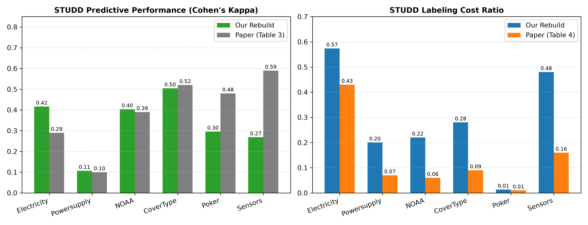
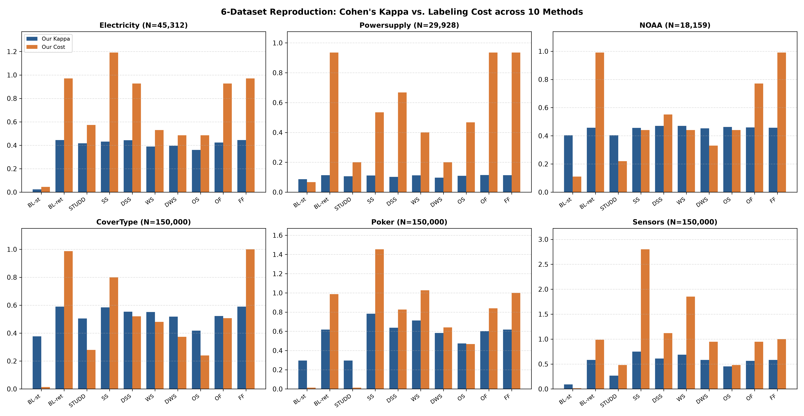

# STUDD

Đồ án Nhập môn học máy

Nghiên cứu, thực nghiệm và cài đặt lại (reproduce) mô hình **STUDD** dựa trên bài báo khoa học:

> **STUDD: A Student–Teacher Method for Unsupervised Concept Drift Detection**  
> *Vitor Cerqueira, Heitor Murilo Gomes, Albert Bifet, Luis Torgo* (Dalhousie University, University of Waikato, Télécom ParisTech).  
> Công bố tại: **Machine Learning (Springer 2023)**, pages 4351–4378.  
> Xếp hạng (Rank): **Q1** (SCIE / Scopus).

---

## 1. Tổng quan về Bài nghiên cứu STUDD

### 1.1. Bối cảnh & Bài toán Concept Drift
Trong các hệ thống học máy triển khai trên luồng dữ liệu thời gian thực (Data Streams) như IoT, phát hiện gian lận tài chính hay dự báo phụ tải điện năng, môi trường luôn biến động khiến phân phối dữ liệu $P(X, Y)$ thay đổi theo thời gian. Hiện tượng này được gọi là **Trôi dạt khái niệm (Concept Drift)**, làm cho mô hình học máy huấn luyện trên dữ liệu cũ bị suy giảm độ chính xác nghiêm trọng.

### 1.2. Hạn chế của các phương pháp truyền thống
Phần lớn các thuật toán phát hiện Concept Drift kinh điển (như DDM, EDDM, ADWIN, Page-Hinkley giám sát) đều thuộc nhóm **có giám sát (supervised)**. Chúng đòi hỏi hệ thống phải có **nhãn thực tế tức thì ($y_t$)** ngay sau mỗi dự đoán để đo lường sai số. Tuy nhiên, trong thực tế sản xuất:
* Việc gán nhãn thực tế tốn kém chi phí chuyên gia rất lớn.
* Nhãn thường bị trễ thời gian rất dài (delayed feedback) hoặc hoàn toàn không có nhãn (unlabeled stream).

### 1.3. Giải pháp của STUDD (Student-Teacher Drift Detection)
Bài báo nghiên cứu đề xuất phương pháp **STUDD** (*A Student-Teacher Method for Unsupervised Concept Drift Detection* - Cerqueira et al., *Machine Learning* 2023 Springer) nhằm phát hiện trôi dạt mà **không cần nhãn thực tế** theo cơ chế sau:
1. **Kiến trúc Thầy - Trò (Teacher - Student Paradigm):**
   * **Teacher ($T$):** Mô hình tĩnh ban đầu, đóng vai trò chuyên gia tham chiếu đưa ra nhãn dự đoán $\hat{y}_{t, T}$.
   * **Student ($S$):** Mô hình học trực tuyến (online learner), được huấn luyện để **học bắt chước** hành vi của Teacher. Nhãn mà Student học theo chính là dự đoán của Teacher $\hat{y}_{t, T}$, hoàn toàn không cần nhãn thật $y_t$.
2. **Cơ chế Phát hiện Trôi dạt (Unsupervised Detection):**
   * Với mỗi mẫu dữ liệu mới $x_t$, cả Teacher và Student cùng đưa ra dự đoán. Sai số bắt chước (Mimicry Loss / Discrepancy) $L_t = \mathbb{I}(\hat{y}_{t, T} \neq \hat{y}_{t, S})$ được theo dõi liên tục thông qua thuật toán kiểm định tuần tự **Page-Hinkley (PH)**.
   * Khi dữ liệu ổn định, Student bắt chước Teacher rất tốt ($L_t \approx 0$). Khi Concept Drift xảy ra, phân phối dữ liệu biến đổi khiến Student và Teacher phát sinh bất đồng lớn $\rightarrow$ Giá trị tích lũy Page-Hinkley tăng vọt vượt ngưỡng cho phép ($\lambda$), kích hoạt cảnh báo phát hiện Concept Drift.
3. **Thích nghi Tối ưu Chi phí (Active Adaptive Retraining):**
   * Chỉ khi có tín hiệu cảnh báo Drift từ STUDD, hệ thống mới yêu cầu nhãn thực tế (True Labels) cho một tập mẫu cục bộ để tái huấn luyện lại Teacher và Student. Nhờ đó, STUDD giúp cân bằng tối ưu giữa **hiệu năng mô hình** và **tiết kiệm tối đa chi phí gán nhãn**.

---

## 2. Các Cột mốc & Bài nộp Đồ án

* **Giai đoạn 1:** Milestone 1 (Chọn bài báo) ──► Nộp form đăng ký (Pass/Fail)
* **Giai đoạn 2:** Milestone 2 (Đọc hiểu) + Lab 1 (Tái hiện thực nghiệm) ──► Nộp **SLIDE GIỮA KỲ (45% điểm)**
  * **Hạn nộp:** 21/11
  * **Sản phẩm nộp:** File `ID.pptx` (20 – 40 slide, dung lượng $\le$ 20MB, bắt buộc kèm Speaker Notes dưới mỗi slide)
  * **Minh chứng đi kèm:** Nộp link công khai repository GitHub mã nguồn
* **Giai đoạn 3:** Milestone 3 (Phản biện lý thuyết) + Lab 2 (Stress test thực nghiệm) ──► Nộp **POSTER CUỐI KỲ (50% điểm)**
  * **Sản phẩm nộp:** File `ID.pptx` (Poster workshop)
* **Kỷ luật thực nghiệm (5% điểm):** Chất lượng repository GitHub và theo dõi thực nghiệm đầy đủ trên Weights & Biases (W&B)
  * **W&B Project Dashboard:** [https://wandb.ai/lgkai-hcmus/STUDD](https://wandb.ai/lgkai-hcmus/STUDD)

---

## 3. Cấu trúc Thư mục Dự án

```text
Project1_STUDD/
├── data/                             # Dữ liệu chuẩn (hosted HF/USP cache) và manifest nguồn
│   └── hosted_sources.json           # Cấu hình nguồn tải tự động & SHA-256
├── src/                              # Mã nguồn tự cài đặt STUDD, Page-Hinkley, baselines & data loader
│   ├── __init__.py                   # Đóng gói package src
│   ├── detector.py                   # Module 1: Thuật toán kiểm định tuần tự Page-Hinkley
│   ├── studd.py                      # Module 2: Kiến trúc Teacher - Student & mô hình Bảng 2
│   ├── data_loader.py                # Module 3: Bộ nạp luồng tự động từ HF/USP/OpenML
│   └── baselines.py                  # Module 4: 10 phương pháp đối sánh (Mục 5.5) & độ đo cảnh báo
├── experiments/                      # Kịch bản chạy thực nghiệm (Reproduction & Stress Testing)
│   ├── reproduce.py                  # Kịch bản tái hiện cơ bản (3 luồng)
│   ├── reproduce_dat_6datasets.py    # Kịch bản tái hiện đầy đủ 10 phương pháp trên 6 bộ (cap 150k)
│   └── stress_test.py                # Kịch bản kiểm thử chịu tải và phản biện lý thuyết
├── notebooks/                        # Jupyter Notebooks phân tích và trực quan hóa kết quả
├── results/                          # Bảng CSV kết quả và biểu đồ 300 DPI
├── docs/                             # Bài báo gốc STUDD và báo cáo kiểm tra 19 bộ dữ liệu
├── .gitignore                        # Cấu hình bỏ qua môi trường ảo, cache nặng và tài liệu nháp
├── requirements.txt                  # Danh sách thư viện phụ thuộc Python 3.9+
└── README.md                         # Tài liệu giới thiệu đề tài, hướng dẫn và bảng ánh xạ W&B
```

---

## 4. Hướng dẫn Cài đặt & Chạy Thực nghiệm

### Bước 1: Khởi tạo và kích hoạt môi trường ảo
Khuyến nghị sử dụng Python 3.9 trở lên (đã kiểm thử trên Python 3.13):

* **Trên Windows (PowerShell):**
  ```powershell
  python -m venv venv
  .\venv\Scripts\Activate.ps1
  ```
* **Trên Linux / macOS:**
  ```bash
  python3 -m venv venv
  source venv/bin/activate
  ```

### Bước 2: Cài đặt các thư viện phụ thuộc
```powershell
pip install -r requirements.txt
```

### Bước 3: Đăng nhập tài khoản Weights & Biases (W&B)
Để đồng bộ kết quả thực nghiệm lên dashboard của nhóm:
```powershell
python -m wandb login
```
*(Lấy API key tại [https://wandb.ai/authorize](https://wandb.ai/authorize) và dán vào terminal khi được nhắc)*

### Bước 4: Kiểm thử các module độc lập (Unit Test)
```powershell
# 1. Kiểm thử thuật toán kiểm định tuần tự Page-Hinkley (Module 1)
python src/detector.py

# 2. Kiểm thử khung làm việc Teacher - Student & mô hình Bảng 2 (Module 2)
python src/studd.py

# 3. Kiểm thử bộ nạp tự động 6 bộ dữ liệu (Module 3)
python src/data_loader.py

# 4. Kiểm thử đầy đủ 10 phương pháp đối sánh & độ đo cảnh báo (Module 4)
python src/baselines.py
```

### Bước 5: Chạy thực nghiệm tái hiện (Reproduction Experiments)

* **Chạy thử nghiệm cơ bản (3 luồng):**
  ```powershell
  python experiments/reproduce.py
  ```
* **Chạy tái hiện đầy đủ 10 phương pháp trên 6 bộ dữ liệu (tuần tự, giới hạn 150.000 mẫu/luồng):**
  ```powershell
  # Chạy offline toàn bộ 6 bộ (hoặc chọn riêng với --datasets electricity)
  python experiments/reproduce_dat_6datasets.py --no-wandb --aggregate

  # Chạy và đẩy trực tiếp lên W&B (sau khi đã wandb login)
  python experiments/reproduce_dat_6datasets.py --aggregate

  # Hoặc đồng bộ các kết quả CSV/PNG đã chạy từ results/ lên W&B
  python experiments/reproduce_dat_6datasets.py --sync-wandb
  ```

---

## 5. Thư viện ngoài Stack chuẩn & Bảng Ánh xạ Thực nghiệm (6 Bộ dữ liệu)

### 5.1. Giải trình thư viện ngoài stack `numpy` / `scipy` / `scikit-learn`
* `xgboost`: Bắt buộc để tái hiện đúng bộ phân lớp `XGB` (Extreme Gradient Boosting) được bài báo dùng làm Student/Teacher trong Bảng 2 (ví dụ trên `Electricity`).
* `requests`, `huggingface-hub`, `pyarrow`, `openml`: Hỗ trợ nạp dữ liệu tự động qua mã nguồn từ Hugging Face, USP repository và OpenML kèm kiểm tra định dạng CSV/Parquet.
* `pandas`, `matplotlib`, `seaborn`: Xử lý dữ liệu bảng luồng và xuất biểu đồ phân tích chuẩn 300 DPI.
* `wandb`: Theo dõi và lưu trữ tập trung cấu hình, chỉ số, bảng biểu và đồ thị tại [W&B lgkai-hcmus/STUDD](https://wandb.ai/lgkai-hcmus/STUDD).

### 5.2. Bảng Ánh xạ Thực nghiệm & W&B Runs (6 Bộ dữ liệu — Đạt, $W = 2000$, cap $150,000$)

| Thực nghiệm / Bộ dữ liệu | Script tạo kết quả | W&B Run Link | File lưu trữ | Kết luận chính của Run |
|---|---|---|---|---|
| **Electricity** ($N=45,312$, `NB/XGB`) | `experiments/reproduce_dat_6datasets.py --datasets electricity` | [W&B `vlj7zc8h`](https://wandb.ai/lgkai-hcmus/STUDD/runs/vlj7zc8h) | [electricity_reproduction.csv](results/electricity_reproduction.csv) | `STUDD` đạt $\kappa=0.4166$ (Paper `0.29`), giảm >50% báo động so với `SS` (12 vs. 26). |
| **Powersupply** ($N=29,928$, `SVC/RF`) | `experiments/reproduce_dat_6datasets.py --datasets powersupply` | [W&B `pkbdf0np`](https://wandb.ai/lgkai-hcmus/STUDD/runs/pkbdf0np) | [powersupply_reproduction.csv](results/powersupply_reproduction.csv) | `STUDD` đạt $\kappa=0.1067$ (sát Paper `0.10`), Label Efficiency cao nhất (`0.4112`, 2 alarms). |
| **NOAA** ($N=18,159$, `RF/RF`) | `experiments/reproduce_dat_6datasets.py --datasets noaa` | [W&B `lyhf11v9`](https://wandb.ai/lgkai-hcmus/STUDD/runs/lyhf11v9) | [noaa_reproduction.csv](results/noaa_reproduction.csv) | `STUDD` đạt $\kappa=0.4036$ (sát Paper `0.39`), tiết kiệm nhãn nhất (`1` alarm, Eff. `0.5007`). |
| **CoverType** ($N=150,000$, `LR/LR`) | `experiments/reproduce_dat_6datasets.py --datasets covertype` | [W&B `r6s8kd07`](https://wandb.ai/lgkai-hcmus/STUDD/runs/r6s8kd07) | [covertype_reproduction.csv](results/covertype_reproduction.csv) | `STUDD` đạt $\kappa=0.5046$ (lệch `-2.95%` so với Paper `0.52`), ít hơn gần 3× báo động so với `SS` (20 vs. 59). |
| **Poker** ($N=150,000$, `DT/DT`) | `experiments/reproduce_dat_6datasets.py --datasets poker` | [W&B `pub91li5`](https://wandb.ai/lgkai-hcmus/STUDD/runs/pub91li5) | [poker_reproduction.csv](results/poker_reproduction.csv) | `STUDD` phát `0` báo động ($\max PH_t < 50$ do over-mimicking `DT/DT`), $\kappa=0.2960$, Cost `0.0133` (Paper `0.01`). |
| **Sensors** ($N=150,000$, `DT/DT`) | `experiments/reproduce_dat_6datasets.py --datasets sensors` | [W&B `kd3shf5o`](https://wandb.ai/lgkai-hcmus/STUDD/runs/kd3shf5o) | [sensors_reproduction.csv](results/sensors_reproduction.csv) | `STUDD` phát `35` báo động ($\kappa=0.2684$, Cost `0.4800`), thấp hơn `SS` (`0.7499`, `209` alarms) trên bài toán 52–54 lớp. |
| **Tổng hợp 6 bộ & Đồ thị 300 DPI** | `experiments/reproduce_dat_6datasets.py --aggregate` | [W&B `iuigzb01`](https://wandb.ai/lgkai-hcmus/STUDD/runs/iuigzb01) | [dat_6datasets_summary.csv](results/dat_6datasets_summary.csv) | Tổng hợp 60 run (6 bộ × 10 phương pháp), bảng cảnh báo (`FAR = 0.0`, `MDR = 0.1667`) và 2 đồ thị 300 DPI. |

### 5.3. Tổng hợp Kết quả 10 Phương pháp trên 6 Bộ dữ liệu (Ours / Paper Bảng 3 & 4)

#### A. Cohen's Kappa ($\kappa$ — Our Rebuild / Paper Table 3)

| Dataset | BL-st | BL-ret | **STUDD** | SS | DSS | WS | DWS | OS | OF | FF |
|---|---|---|---|---|---|---|---|---|---|---|
| **Electricity** | `0.0239` / `0.13` | `0.4451` / `0.39` | **`0.4166`** / `0.29` | `0.4313` / `0.39` | `0.4433` / `0.39` | `0.3887` / `0.39` | `0.3964` / `0.34` | `0.3608` / `0.33` | `0.4230` / `0.38` | `0.4451` / `0.39` |
| **Powersupply** | `0.0865` / `0.09` | `0.1136` / `0.11` | **`0.1067`** / `0.10` | `0.1110` / `0.11` | `0.1024` / `0.09` | `0.1130` / `0.11` | `0.0970` / `0.11` | `0.1099` / `0.11` | `0.1147` / `0.10` | `0.1132` / `0.11` |
| **NOAA** | `0.4031` / `0.39` | `0.4569` / `0.45` | **`0.4036`** / `0.39` | `0.4563` / `0.44` | `0.4708` / `0.43` | `0.4700` / `0.46` | `0.4523` / `0.41` | `0.4631` / `0.46` | `0.4598` / `0.40` | `0.4569` / `0.46` |
| **CoverType** | `0.3767` / `0.50` | `0.5895` / `0.67` | **`0.5046`** / `0.52` | `0.5848` / `0.63` | `0.5530` / `0.58` | `0.5514` / `0.53` | `0.5183` / `0.53` | `0.4176` / `0.33` | `0.5230` / `0.54` | `0.5895` / `0.66` |
| **Poker** | `0.2960` / `0.28` | `0.6189` / `0.46` | **`0.2960`** / `0.48` | `0.7838` / `0.65` | `0.6376` / `0.61` | `0.7121` / `0.68` | `0.5822` / `0.58` | `0.4738` / `0.20` | `0.6021` / `0.18` | `0.6189` / `0.45` |
| **Sensors** | `0.0906` / `0.11` | `0.5831` / `0.67` | **`0.2684`** / `0.59` | `0.7499` / `0.83` | `0.6101` / `0.63` | `0.6872` / `0.77` | `0.5812` / `0.56` | `0.4535` / `0.53` | `0.5653` / `0.60` | `0.5831` / `0.67` |

#### B. Chi phí Gán nhãn (Labeling Cost Ratio — Our Rebuild / Paper Table 4)

| Dataset | BL-st | BL-ret | **STUDD** | SS | DSS | WS | DWS | OS | OF | FF |
|---|---|---|---|---|---|---|---|---|---|---|
| **Electricity** | `0.0441` / `0.02` | `0.9710` / `0.99` | **`0.5738`** / `0.43` | `1.1917` / `0.69` | `0.9269` / `0.51` | `0.5297` / `0.82` | `0.4855` / `0.29` | `0.4855` / `0.09` | `0.9269` / `0.38` | `0.9710` / `0.99` |
| **Powersupply** | `0.0668` / `0.03` | `0.9356` / `0.97` | **`0.2005`** / `0.07` | `0.5346` / `0.30` | `0.6683` / `0.10` | `0.4010` / `0.33` | `0.2005` / `0.20` | `0.4678` / `0.43` | `0.9356` / `0.57` | `0.9356` / `0.94` |
| **NOAA** | `0.1101` / `0.06` | `0.9912` / `0.99` | **`0.2203`** / `0.06` | `0.4406` / `0.22` | `0.5507` / `0.22` | `0.4406` / `0.28` | `0.3304` / `0.17` | `0.4406` / `0.28` | `0.7710` / `0.22` | `0.9912` / `0.99` |
| **CoverType** | `0.0133` / `0.01` | `0.9867` / `0.99` | **`0.2800`** / `0.09` | `0.8000` / `0.49` | `0.5200` / `0.42` | `0.4800` / `0.51` | `0.3733` / `0.16` | `0.2400` / `0.09` | `0.5067` / `0.29` | `1.0000` / `0.99` |
| **Poker** | `0.0133` / `0.01` | `0.9867` / `0.97` | **`0.0133`** / `0.01` | `1.4533` / `2.69` | `0.8267` / `2.51` | `1.0267` / `4.51` | `0.6400` / `3.45` | `0.4667` / `0.43` | `0.8400` / `0.62` | `1.0000` / `0.97` |
| **Sensors** | `0.0133` / `0.01` | `0.9867` / `0.99` | **`0.4800`** / `0.16` | `2.8000` / `1.43` | `1.1200` / `0.51` | `1.8533` / `2.05` | `0.9467` / `0.71` | `0.4800` / `0.37` | `0.9467` / `0.47` | `1.0000` / `0.99` |

#### C. Chỉ số Cảnh báo Trung bình trên 6 Bộ (Đối chiếu Bảng 5 bài báo)

| Method | Our MDR (6 bộ) | Paper MDR (16 bộ) | Our FAR (6 bộ) | Paper FAR (16 bộ) | Our MTD | Paper MTD | Our MTFA | Paper MTFA |
|---|---|---|---|---|---|---|---|---|
| **STUDD** | `0.1667` | `0.19` | **`0.0000`** | `0.00` | `0.2165` | `0.09` | `NA` | `NA` |
| **DSS** | `0.0000` | `0.06` | `0.0000` | `0.00` | `0.0653` | `0.14` | `NA` | `NA` |
| **WS** | `0.0000` | `0.12` | `0.0000` | `0.00` | `0.1104` | `0.14` | `NA` | `NA` |
| **DWS** | `0.0000` | `0.19` | `0.0000` | `0.00` | `0.1322` | `0.16` | `NA` | `NA` |
| **OS** | `0.0000` | `0.06` | `0.0000` | `0.12` | `0.1261` | `0.12` | `NA` | `0.44` |
| **OF** | `0.0000` | `0.06` | `0.1667` | `0.12` | `0.0498` | `0.11` | `0.0267` | `0.30` |
| **FF** | `0.0000` | `0.00` | `0.1667` | `0.25` | `0.0495` | `0.07` | `0.0267` | `0.15` |




> **Phân tích độ lệch & đối chiếu code gốc (`vcerqueira/studd`):**
> 1. **Kích thước cửa sổ $W=2000$ vs. $W=1000$:** Văn bản Mục 5.7 ghi $W = 2000$, nhưng `experiments/main.py` trong repo gốc của tác giả thực tế đặt `W = 1000` cho các luồng lớn (khớp chính xác tỷ lệ `BL-st = 1000 / N` ở Bảng 4: `0.02` cho Electricity, `0.03` cho Powersupply, `0.06` cho NOAA, `0.01` cho CoverType/Poker/Sensors).
> 2. **Tham số $\delta$ và bộ đệm Student:** Repo gốc truyền `delta = 0.002` cho các phương pháp giám sát nhưng chia đôi `delta / 2 = 0.001` riêng cho `STUDD`, đồng thời huấn luyện lại Student trên toàn bộ lịch sử tích lũy; bản tái hiện giữ thống nhất $\delta = 0.001$ và cửa sổ $W=2000$ mẫu gần nhất đúng theo mô tả bài báo.
> 3. **Hành vi `DT/DT` trên `Poker` và `Sensors`:** Trên `Poker`, cây quyết định không giới hạn độ sâu ghi nhớ rất tốt cửa sổ `2,000` mẫu (`L_t` trung bình chỉ ~`0.0087`), khiến thống kê Page-Hinkley cực đại chưa vượt ngưỡng $\lambda = 50.0$ (0 báo động). Trên `CoverType`, dữ liệu chuẩn UCI/HF có đủ 7 lớp (so với 5 lớp in ở Bảng 1).
> 4. **Chi tiết đầy đủ:** Xem [results/dat_6datasets_summary.csv](results/dat_6datasets_summary.csv) và [results/dat_6datasets_alarm_summary.csv](results/dat_6datasets_alarm_summary.csv).

## Dataset branch snapshot

The `data` branch adds the dataset files and [19-dataset source report](docs/dataset_reports/STUDD_19_DATASETS_REPORT.md). Original HF links and external upstream links are both retained. See [data/README.md](data/README.md) for folder meanings and verification limitations. These files do not constitute new model results.
