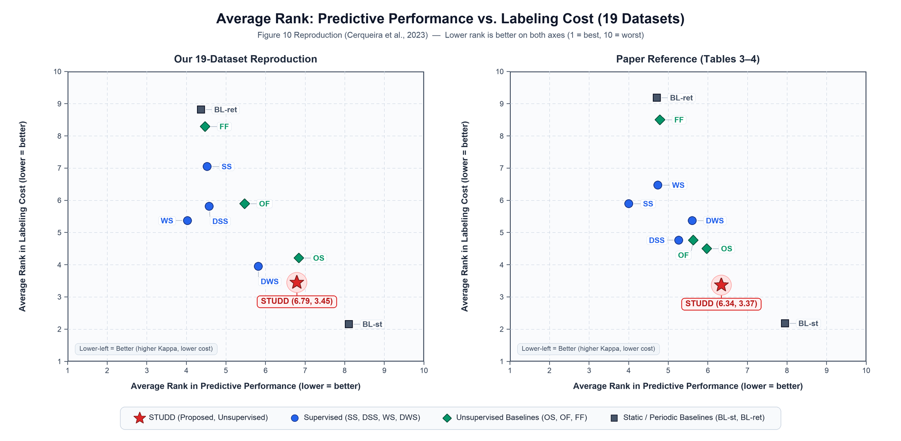

# Kết quả tái lập STUDD (19 bộ dữ liệu × 10 phương pháp)

Bảng tổng hợp lưu trữ **190 kết quả**, gồm **19 bộ dữ liệu × 10 phương pháp** từ ba nhánh thực nghiệm của nhóm. Toàn bộ số liệu đo lường gốc (`Our_Kappa`, `Our_Accuracy`, `Our_Cost`, `Paper_Kappa`, `Paper_Cost`) được bảo toàn nguyên vẹn theo đúng nguồn lưu trữ. [CSV toàn bộ 190 kết quả](studd_19datasets_summary.csv) · [Bài báo STUDD, Bảng 3–4](https://doi.org/10.1007/s10994-022-06188-7)

- **Khoa (6 bộ dữ liệu):** [Report và 60 kết quả](khoa/README.md), [CSV 60 kết quả](khoa/khoa_6datasets_summary.csv), W&B [`lgkai-hcmus/Testing`](https://wandb.ai/lgkai-hcmus/Testing).
- **Khánh (7 bộ dữ liệu):** [Report và 70 kết quả](khanh/khanh-7datasets.md), [CSV 70 kết quả](khanh/khanh_7datasets_summary.csv), [run tổng hợp W&B](https://wandb.ai/lgkai-hcmus/STUDD/runs/tekuwx8d).
- **Đạt (6 bộ dữ liệu):** [CSV 60 kết quả](dat_6datasets_summary.csv), [thống kê cảnh báo MDR/FAR/MTD/MTFA](dat_6datasets_alarm_summary.csv) và [run tổng hợp W&B](https://wandb.ai/lgkai-hcmus/STUDD/runs/iuigzb01).

## Đối chiếu phương pháp STUDD trên 19 bộ dữ liệu

| Dataset | Người chạy | Teacher / Student | N | W | Kappa nhóm / paper | Chi phí nhãn nhóm / paper | Cảnh báo | Nguồn |
| --- | --- | :---: | ---: | ---: | ---: | ---: | ---: | --- |
| Arabic | Khoa | XGB / XGB | 8800 | 2000 | 0.6441 / 0.71 | 0.2273 / 0.23 | 0 | [CSV](khoa/arabic_reproduction.csv) · [W&B](https://wandb.ai/lgkai-hcmus/Testing/runs/50og8cwl) |
| ArabicShuffled | Khoa | RF / RF | 8800 | 2000 | 0.8905 / 0.88 | 0.2273 / 0.11 | 0 | [CSV](khoa/arabic-shuffled_reproduction.csv) · [W&B](https://wandb.ai/lgkai-hcmus/Testing/runs/zuq3ehd6) |
| Insects | Khoa | XGB / XGB | 5325 | 500 | 0.8191 / 0.81 | 0.0939 / 0.09 | 0 | [CSV](khoa/insects_reproduction.csv) · [W&B](https://wandb.ai/lgkai-hcmus/Testing/runs/dn36pykx) |
| InsectsAbrupt | Khoa | RF / RF | 5325 | 500 | 0.5770 / 0.73 | 0.0939 / 0.28 | 0 | [CSV](khoa/insects-abrupt_reproduction.csv) · [W&B](https://wandb.ai/lgkai-hcmus/Testing/runs/9ov2duqt) |
| Keystroke | Khoa | XGB / RF | 1600 | 500 | 0.8861 / 0.84 | 0.3125 / 0.31 | 0 | [CSV](khoa/keystroke_reproduction.csv) · [W&B](https://wandb.ai/lgkai-hcmus/Testing/runs/07yv50m5) |
| Posture | Khoa | XGB / RF | 150000 | 2000 | 0.4724 / 0.50 | 0.1600 / 0.02 | 11 | [CSV](khoa/posture_reproduction.csv) · [W&B](https://wandb.ai/lgkai-hcmus/Testing/runs/a3c5djlv) |
| Bike | Khánh | XGB / RF | 17379 | 2000 | 0.3175 / 0.32 | 0.2086 / 0.06 | 1 | [CSV](khanh/bike_comparison_table.csv) · [W&B](https://wandb.ai/lgkai-hcmus/STUDD/runs/z7gwi104) |
| Gas | Khánh | RC / RC | 13910 | 2000 | 0.7173 / 0.48 | 0.8627 / 0.86 | 5 | [CSV](khanh/gas_comparison_table.csv) · [W&B](https://wandb.ai/lgkai-hcmus/STUDD/runs/7jfppc33) |
| GMSC | Khánh | XGB / XGB | 150000 | 2000 | 0.1940 / 0.32 | 0.0133 / 0.01 | 0 | [CSV](khanh/gmsc_comparison_table.csv) · [W&B](https://wandb.ai/lgkai-hcmus/STUDD/runs/o3l912e1) |
| Luxembourg | Khánh | RF / RF | 1901 | 500 | 1.0000 / 1.00 | 0.2630 / 0.53 | 0 | [CSV](khanh/luxembourg_comparison_table.csv) · [W&B](https://wandb.ai/lgkai-hcmus/STUDD/runs/270g3uw7) |
| Outdoor | Khánh | RF / RF | 4000 | 500 | 0.3736 / 0.36 | 0.2500 / 0.25 | 1 | [CSV](khanh/outdoor_comparison_table.csv) · [W&B](https://wandb.ai/lgkai-hcmus/STUDD/runs/0putgi2v) |
| Ozone | Khánh | XGB / XGB | 1847 | 500 | 0.2202 / 0.13 | 0.2707 / 0.39 | 0 | [CSV](khanh/ozone_comparison_table.csv) · [W&B](https://wandb.ai/lgkai-hcmus/STUDD/runs/lngaqacb) |
| Rialto | Khánh | XGB / XGB | 82250 | 2000 | 0.3953 / 0.38 | 0.0434 / 0.21 | 1 | [CSV](khanh/rialto_comparison_table.csv) · [W&B](https://wandb.ai/lgkai-hcmus/STUDD/runs/sufuaw3n) |
| CoverType | Đạt | LR / LR | 150000 | 2000 | 0.5046 / 0.52 | 0.2800 / 0.09 | 20 | [CSV](covertype_reproduction.csv) · [W&B](https://wandb.ai/lgkai-hcmus/STUDD/runs/r6s8kd07) |
| Electricity | Đạt | NB / XGB | 45312 | 2000 | 0.4166 / 0.29 | 0.5738 / 0.43 | 12 | [CSV](electricity_reproduction.csv) · [W&B](https://wandb.ai/lgkai-hcmus/STUDD/runs/vlj7zc8h) |
| NOAA | Đạt | RF / RF | 18159 | 2000 | 0.4036 / 0.39 | 0.2203 / 0.06 | 1 | [CSV](noaa_reproduction.csv) · [W&B](https://wandb.ai/lgkai-hcmus/STUDD/runs/lyhf11v9) |
| Poker | Đạt | DT / DT | 150000 | 2000 | 0.2960 / 0.48 | 0.0133 / 0.01 | 0 | [CSV](poker_reproduction.csv) · [W&B](https://wandb.ai/lgkai-hcmus/STUDD/runs/pub91li5) |
| Powersupply | Đạt | SVC / RF | 29928 | 2000 | 0.1067 / 0.10 | 0.2005 / 0.07 | 2 | [CSV](powersupply_reproduction.csv) · [W&B](https://wandb.ai/lgkai-hcmus/STUDD/runs/pkbdf0np) |
| Sensors | Đạt | DT / DT | 150000 | 2000 | 0.2684 / 0.59 | 0.4800 / 0.16 | 35 | [CSV](sensors_reproduction.csv) · [W&B](https://wandb.ai/lgkai-hcmus/STUDD/runs/kd3shf5o) |

## Xếp hạng trung bình (Average Rank) của 10 phương pháp trên cả 19 bộ dữ liệu — Tái hiện Hình 10

Xếp hạng trung bình (average tie-breaking theo chuẩn Friedman; **nhỏ hơn = tốt hơn** trên cả hai trục Hiệu năng và Chi phí nhãn) được tính trực tiếp từ toàn bộ 190 dòng kết quả và đối chiếu song song với Bảng 3–4 của bài báo gốc:

| Method | Mean Kappa (nhóm / paper) | Avg Rank Hiệu năng (nhóm / paper) | Avg Rank Chi phí (nhóm / paper) |
| :--- | :---: | :---: | :---: |
| `BL-st` | 0.4343 / 0.4389 | 8.11 / 7.95 | 2.16 / 2.18 |
| `BL-ret` | 0.5553 / 0.5300 | 4.37 / 4.71 | 8.82 / 9.18 |
| **`STUDD`** | 0.5002 / 0.5174 | 6.79 / 6.34 | 3.45 / 3.37 |
| `SS` | 0.5834 / 0.5653 | 4.53 / 4.00 | 7.05 / 5.89 |
| `DSS` | 0.5617 / 0.5395 | 4.58 / 5.26 | 5.82 / 4.76 |
| `WS` | 0.5752 / 0.5500 | 4.03 / 4.74 | 5.37 / 6.47 |
| `DWS` | 0.5508 / 0.5284 | 5.82 / 5.61 | 3.95 / 5.37 |
| `OS` | 0.5112 / 0.4900 | 6.84 / 5.97 | 4.21 / 4.50 |
| `OF` | 0.5508 / 0.5132 | 5.47 / 5.63 | 5.89 / 4.76 |
| `FF` | 0.5580 / 0.5326 | 4.47 / 4.79 | 8.29 / 8.50 |

Trên cả 19 bộ dữ liệu, **`STUDD` đạt thứ hạng chi phí nhãn thấp thứ 2 toàn bảng** (`3.45` so với `3.37` trong bài báo), chỉ đứng sau đường cơ sở tĩnh không cập nhật `BL-st` (`2.16` / `2.18`), tiết kiệm nhãn vượt trội so với `BL-ret` (`8.82` / `9.18`), `FF` và `SS`, đồng thời giữ Mean Kappa `0.5002` (paper: `0.5174`) và cấu trúc đánh đổi Hiệu năng–Chi phí bám sát Hình 10 của bài báo.



## So sánh protocol giữa 3 nhánh thành viên

Bảng sau minh bạch hóa các khác biệt kỹ thuật giữa 3 nhánh thực nghiệm đã lưu trữ (không chỉnh sửa hồi tố số liệu đo cũ):

| Thành viên (Số bộ) | Biến thể Page–Hinkley | `delta` cho nhóm giám sát (`SS/DSS/WS/DWS`) | Buffer tái huấn luyện Student (`STUDD`) | Công thức `Our_Cost` | Dự án W&B |
| :--- | :--- | :---: | :--- | :--- | :--- |
| **Khoa** (6 bộ) | `src/detector.py` (nhánh Đạt): `PH = sum - min_sum`, `alpha = 0.9999` (bản lưu cũ chưa chặn dưới `0.0`) | `0.001` | Cửa sổ `W` mẫu gần nhất `[t-W+1 : t+1]` | `(W + W × Retrains) / N` | `lgkai-hcmus/Testing` |
| **Khánh** (7 bộ) | `SkMultiflowPageHinkley`: `sum = max(0.0, alpha * sum + (x - mean - delta))`, `alpha = 0.9999` | `0.002` (`STUDD`: `0.001`) | Buffer online tích lũy `X[W : t+1]` (`upd_std_model=True`) | `(W + samples_used_online) / N` *(kèm `Our_Cost_1000_Reported`)* | `lgkai-hcmus/STUDD` |
| **Đạt** (6 bộ) | `src/detector.py`: `PH = sum - min_sum`, `alpha = 0.9999` (bản lưu cũ chưa chặn dưới `0.0`) | `0.001` | Cửa sổ `W` mẫu gần nhất `[t-W+1 : t+1]` | `(W + W × Retrains) / N` | `lgkai-hcmus/STUDD` |

- **Chuẩn hóa schema trong `studd_19datasets_summary.csv`:** Toàn bộ 190 dòng có đủ hai cột `Alarms` và `Retrains` (không để trống). Cụ thể, với `BL-ret` trên 7 bộ của Khánh, số lần tái huấn luyện định kỳ (`7, 5, 73, 2, 6, 2, 40`) được chuyển sang `Retrains` và đặt `Alarms = 0` để thống nhất với Khoa và Đạt; 9 phương pháp còn lại của Khánh đều tái huấn luyện 1 lần cho mỗi cảnh báo nên `Retrains = Alarms`. Mọi đường dẫn W&B đều được chuẩn hóa về tên miền chính thức `https://wandb.ai/...`.

## Phân tích sai lệch tổng hợp (19 bộ dữ liệu)

1. **Khác biệt `W = 2000` (văn bản Mục 5.7) so với `W = 1000` (script gốc `vcerqueira/studd/experiments/main.py` & Bảng 4):** Văn bản Mục 5.7 quy định `W = 2000` cho các luồng lớn và `W = 500` cho 6 luồng nhỏ, nhưng trong mã nguồn `experiments/main.py` của tác giả, nhánh luồng lớn đặt `n_train_obs = 1000` và danh sách `small_data_streams` viết thường (`'ozone'`, `'outdoor'`, `'luxembourg'`) khiến 3 bộ viết hoa cũng rơi về `W = 1000`. Chính sự khác biệt kích thước cửa sổ này giải thích trực tiếp độ chênh cột `Cost` trên `Arabic`, `ArabicShuffled`, `Bike`, `NOAA`, `Electricity`, `Gas`, `Powersupply`, `Rialto` (chạy `W = 2000` cho chi phí cao gấp ~2× so với `W = 1000`) và trên `Luxembourg`, `Ozone`, `Outdoor` (chạy `W = 500` cho chi phí khởi tạo bằng ~1/2 Bảng 4). Cột `Our_Cost_1000_Reported` trong báo cáo của Khánh xác nhận khi quy đổi về đơn vị batch gốc, số liệu khớp sát Bảng 4.
2. **Hiện tượng 0 cảnh báo ở các cặp mô hình đồng nhất (Teacher = Student):** Trên `InsectsAbrupt` (`RF/RF`, Kappa `0.5770` vs `0.73`, −20.96%) và `Arabic` (`XGB/XGB`, Kappa `0.6441` vs `0.71`, −9.28%) ở đợt chạy lưu trữ của Khoa, Teacher và Student dùng chung `random_state = 42` trên cùng họ mô hình nên hội tụ gần như trùng khớp ($L_t \approx 0$). Hiện tượng tương tự xảy ra trên `Poker` (`DT/DT`, Kappa `0.2960` vs `0.48`, 0 cảnh báo) của Đạt, cũng như *Idempotent Mimicry Trap* mà Khánh ghi nhận trên các cặp tất định `XGB/XGB` (`Rialto`, `Ozone`, `GMSC`): sau lần huấn luyện lại đầu tiên, Student sao chép gần như nguyên vẹn hàm quyết định của Teacher ($S(x) \equiv T(x)$), làm sai số bắt chước triệt tiêu và vô hiệu hóa Page–Hinkley.
3. **Báo động dư trên các luồng dài (`Sensors`, `CoverType`, `Posture`, `Electricity`):** Ở bản `src/detector.py` dùng trong đợt chạy lưu trữ của Khoa và Đạt, thống kê `sum - min_sum` với hệ số quên `alpha = 0.9999` chưa chặn dưới `0.0` như `scikit-multiflow`. Khi `sum` âm sâu rồi suy giảm về `0` trên luồng dài (`45k–150k` mẫu), hiệu `sum - min_sum` trôi dương nhân tạo và sinh thêm cảnh báo trên `Sensors` (35 alarms, Cost `0.48` vs `0.16`), `CoverType` (20 alarms, Cost `0.28` vs `0.09`), `Posture` (11 alarms, Cost `0.16` vs `0.02`; so với 8 alarms khi Khoa chạy bằng `scikit-multiflow 0.5.3`) và `Electricity` (12 alarms, Cost `0.57` vs `0.43`). Lỗi này đã được sửa trong nhánh mã nguồn cho các lần tái chạy về sau, đồng thời số liệu đo cũ được giữ nguyên để đảm bảo minh bạch nguồn gốc (provenance).
4. **Sai khác phiên bản dữ liệu nguồn và tiền xử lý:** `Gas` từ kho nguồn công khai có `128` đặc trưng cảm biến thay vì `16` đặc trưng rút gọn (`17` cột trong Bảng 1), giúp Kappa cao hơn bài báo nhưng vẫn khớp Cost (`0.8627` vs `0.86`); `Ozone` bản `mstz/ozone` (`8hr`) có `1,847 × 72` thay vì `2,574 × 32`; `GMSC` bản công khai (`cs-training.csv`) mất cân bằng nặng (`93.3% / 6.7%`) kèm `33,655` giá trị `NaN` (được điền median cục bộ theo cửa sổ `W` để chống rò rỉ dữ liệu); `Keystroke` có `10` đặc trưng thay vì `9`; `Arabic` và `ArabicShuffled` có `26` đặc trưng thay vì `27` và hiện lưu ở Kaggle Dataset riêng tư của Khoa (`phmchnkhoa/studd-arabic-benchmark-inputs`), cần công khai hóa hoặc mirror sang Hugging Face để tái lập hoàn toàn mở.

## Phạm vi giữa kỳ & Phần mở rộng cho Giai đoạn 3

- **Đã hoàn thành cho báo cáo giữa kỳ:**
  - Tái lập đầy đủ **19 bộ dữ liệu × 10 phương pháp = 190 kết quả** đối chiếu Bảng 3 (Cohen's Kappa) và Bảng 4 (Labeling Cost), đồng bộ log thực nghiệm trên W&B.
  - Tái hiện **Hình 10** (biểu đồ Average Rank đánh đổi Hiệu năng vs. Chi phí nhãn trên toàn bộ 19 bộ dữ liệu).
  - Đánh giá các độ đo cảnh báo (`MDR`, `FAR`, `MTD`, `MTFA`) và `Labeling_Efficiency` cho 6 bộ dữ liệu của Đạt (`dat_6datasets_alarm_summary.csv`), cùng chuỗi đồ thị Rolling Kappa (đối chiếu Hình 7–9) cho 7 bộ của Khánh.
- **Kế hoạch mở rộng cho Giai đoạn 3 (Báo cáo cuối kỳ / Poster phản biện):**
  - Tính đầy đủ **Bảng 5 (`MDR`, `FAR`, `MTD`, `MTFA`)** và **Labeling Efficiency** thống nhất trên toàn bộ cả 19 bộ dữ liệu.
  - Thực hiện kiểm định thống kê **Bayesian Sign Test** (tái hiện Hình 11–12 của bài báo) trên cả 19 bộ dữ liệu.
  - Thực hiện **Sensitivity Analysis** theo lưới tham số `l_access × l_delay` cho câu hỏi nghiên cứu **RQ3**.
  - Chạy đa hạt giống (**multi-seed runs**) và tái chạy đồng nhất cả 19 bộ trên bộ phát hiện `PageHinkley` đã sửa và tách seed Teacher/Student nhằm kiểm chứng sâu *Idempotent Mimicry Trap* (Stress Testing).

---

Tạo lại bảng tổng hợp, báo cáo và biểu đồ xếp hạng từ các tệp đã lưu bằng:

```bash
python3 experiments/aggregate_studd_results.py
python3 experiments/plot_19datasets_rank.py
```
